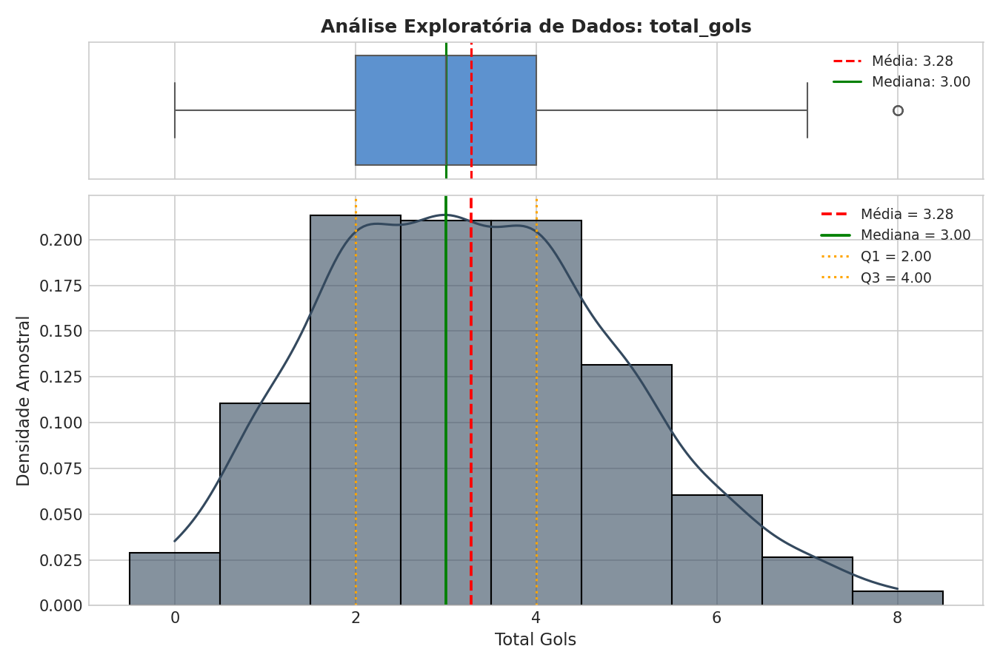
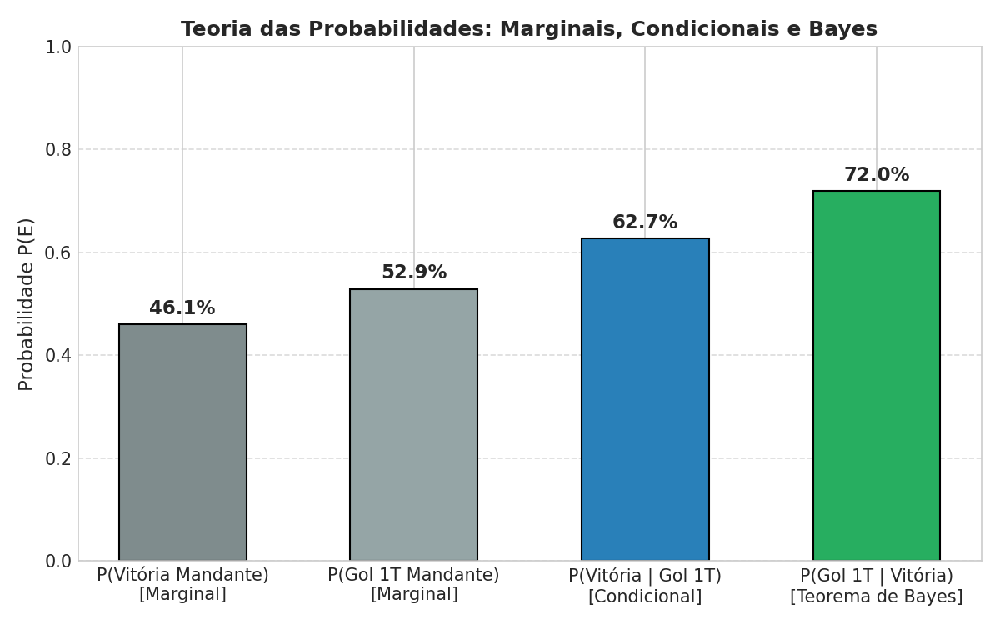
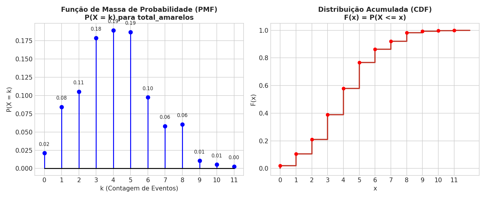
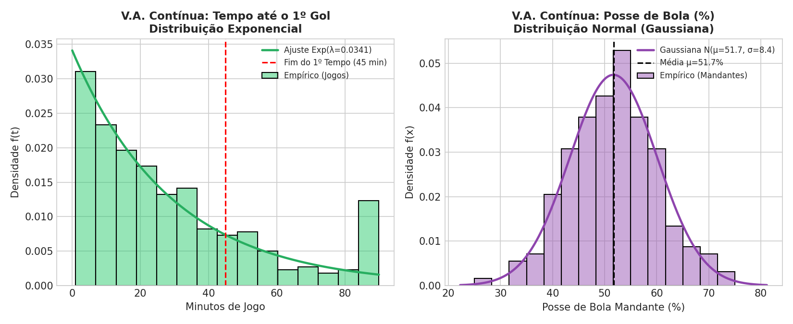
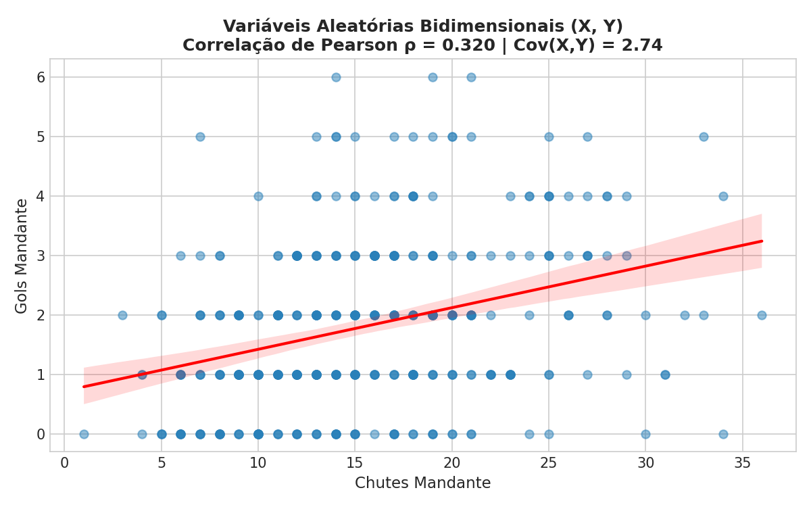
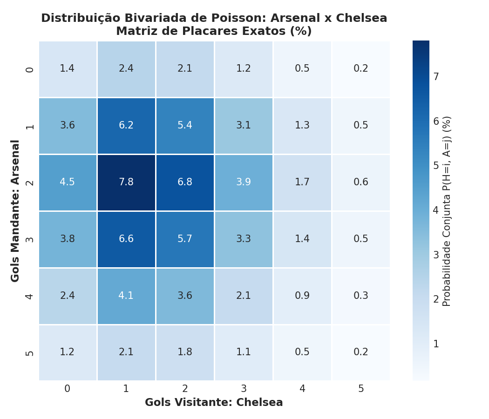
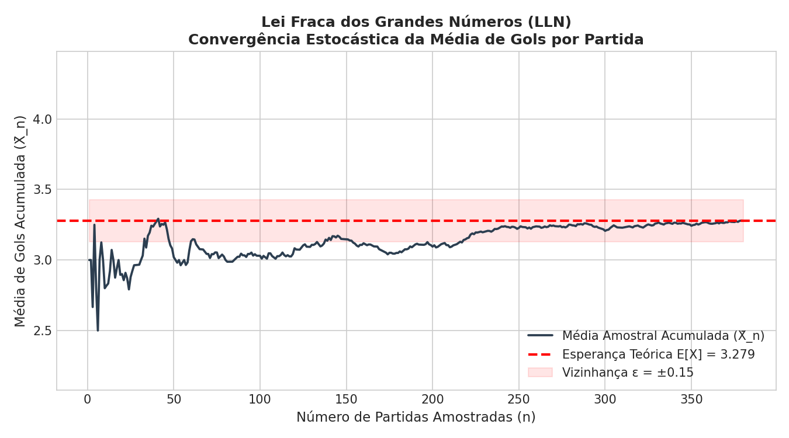
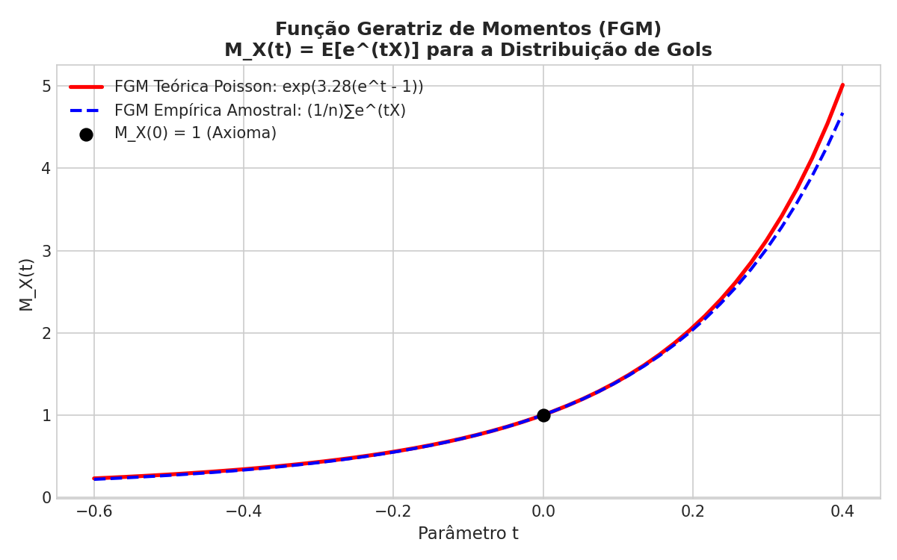
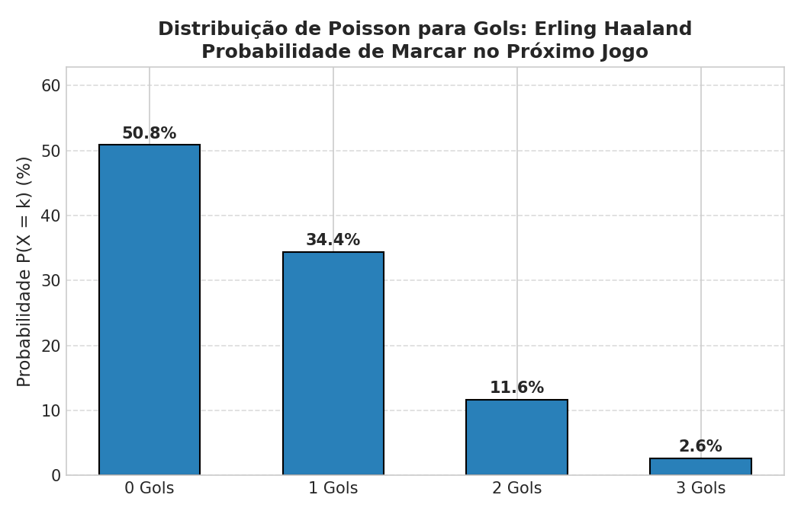
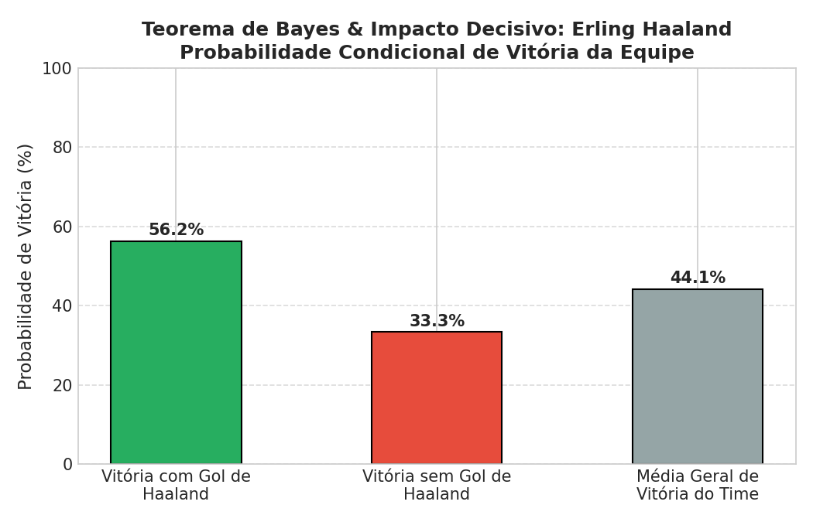

# ⚽ Sistema de Análise Estatística e Probabilística no Futebol

<div align="center">


**Aplicação prática e interativa dos fundamentos de Probabilidade e Estatística no suporte a tomada de decisão no futebol moderno.**

[Visão Geral](#-visão-geral) •
[Conteúdos Implementados](#-conteúdos-da-disciplina-implementados) •
[Consulta de Jogadores e Times](#-consulta-por-time-e-jogador) •
[Galeria de Gráficos](#-galeria-de-gráficos-gerados) •
[Como Executar](#-como-executar) •
[Estrutura](#-estrutura-do-projeto)

</div>

---

## 📌 Visão Geral

O projeto foi concebido para a disciplina de **Probabilidade e Estatística**, transpondo a teoria matemática formal para uma das áreas mais dinâmicas do cotidiano: a **análise de desempenho, scouting e ciência de dados no futebol**.

Utilizando dados coletados via APIs esportivas e repositórios abertos de campeonatos reais (380 partidas da Premier League e histórico jogo a jogo de 59 atletas de ponta), o sistema calcula e projeta:
- Probabilidade de marcar gols no 1º tempo, 2º tempo e jogo todo.
- Matriz bivariada de placares exatos prováveis para qualquer confronto direto.
- Probabilidade de cartões amarelos, escanteios, posse de bola e passes.
- Métricas descritivas e intervalos de confiança para jogadores e clubes.
- Impacto do gol de um craque na vitória do time via Teorema de Bayes.
- Validação computacional da Lei dos Grandes Números e derivação da Função Geratriz de Momentos.

---

## 📚 Conteúdos da Disciplina Implementados

Cada módulo do código-fonte possui comentários pedagógicos explicando a teoria correspondente:

| Tópico da Disciplina | Conceitos Aplicados | Aplicação Prática no Futebol |
| :--- | :--- | :--- |
| **1. Análise Exploratória de Dados (AED)** | Média ($\bar{X}$), Mediana ($Q_2$), Moda, Variâncias ($s^2, \sigma^2$), Desvio Padrão ($s$), Coeficiente de Variação ($CV$), Quartis ($Q_1, Q_3$), Intervalo Interquartil ($IQR$), Assimetria (*Skewness*), Curtose (*Kurtosis*) e Outliers de Tukey. | Análise de variabilidade de finalizações, gols, cartões e posse de equipes e jogadores. |
| **2. Teoria das Probabilidades** | Probabilidade frequentista, Probabilidade Condicional $P(A \mid B) = \frac{P(A \cap B)}{P(B)}$, Teorema de Bayes e Teste de Independência Estocástica $P(A \cap B) \approx P(A) \cdot P(B)$. | $P(\text{Vitória} \mid \text{Gol no 1T})$, $P(\text{Gol no 1T} \mid \text{Vitória})$, e independência entre marcar no 1T e 2T. |
| **3. Variáveis Aleatórias Discretas e Contínuas** | **Discretas:** Suporte, PMF $P(X=k)$, CDF $F(x)$, Esperança $E[X]$ e Variância $Var(X)$.<br>**Contínuas:** PDF $f(x)$, ECDF e cálculo por integrais de intervalos $P(a \le Y \le b) = \int_a^b f(y) dy$. | **Discretas:** Contagem de gols e cartões amarelos.<br>**Contínuas:** Minuto do 1º gol e Posse de bola (%). |
| **4. Variáveis Aleatórias Bidimensionais** | Vetor Aleatório $(X, Y)$, Tabela de Probabilidade Conjunta $P(X=x, Y=y)$, Distribuições Marginais $P(X)$ e $P(Y)$, Covariância $Cov(X, Y)$, Correlação de Pearson ($\rho$) e Correlação Monotônica de Spearman. | Associação entre Chutes e Gols Marcados, Posse de Bola e Volume de Passes. |
| **5. Distribuições de Probabilidades (Discretas e Contínuas)** | • **Poisson:** $P(X=k) = \frac{e^{-\lambda} \lambda^k}{k!}$ com propriedade reprodutiva ($\lambda_{Total} = \lambda_{1T} + \lambda_{2T}$).<br>• **Binomial:** $X \sim Bin(n, p)$ para tentativas e conversão.<br>• **Exponencial:** $T \sim Exp(\lambda)$ para tempo contínuo até o evento.<br>• **Normal:** $X \sim \mathcal{N}(\mu, \sigma^2)$ com regra empírica 68-95-99.7. | • Gols por tempo, cartões e matriz bivariada de placares ($H \times A$).<br>• Finalizações convertidas por atacantes.<br>• Minuto do 1º gol da partida.<br>• Posse de bola da equipe. |
| **6. Leis dos Grandes Números e FGM** | • **Lei Fraca dos Grandes Números (LLN):** $\lim_{n \to \infty} P(\|\bar{X}_n - \mu\| \ge \epsilon) = 0$.<br>• **Função Geratriz de Momentos (FGM):** $M_X(t) = E[e^{tX}]$. Dedução da Poisson $M_X(t) = \exp(\lambda(e^t - 1))$ e derivação analítica: $M'(0) = \lambda = E[X]$, $M''(0) = \lambda + \lambda^2 = E[X^2] \implies Var(X) = \lambda$. | Simulação da convergência acumulada da média de gols ao longo de 380 partidas e comparação empírica vs teórica da FGM. |

---

## 👤 Consulta por Time e Jogador

O software conta com uma área de consulta por atleta e clube:
- **Seleção em Cascata:** Escolha o clube (ex: *Man City, Arsenal, Liverpool, Real Madrid, etc.*) e selecione qualquer atleta do elenco.
- **Poisson do Jogador:** Probabilidade de marcar no 1º tempo, no 2º tempo, no jogo todo e chance de receber cartão amarelo.
- **Conversão Binomial:** Simulação interativa onde o usuário escolhe $n$ chutes e o sistema calcula a probabilidade de converter gols com base na taxa histórica do jogador.
- **Teorema de Bayes (Impacto Tático):**
  $$P(\text{Vitória} \mid \text{Jogador Marcou}) \quad \text{vs} \quad P(\text{Vitória} \mid \text{Jogador Não Marcou})$$
  $$P(\text{Jogador Marcou} \mid \text{Time Venceu}) = \frac{P(\text{Vitória} \mid \text{Marcou}) \cdot P(\text{Marcou})}{P(\text{Vitória})}$$

---

## 📊 Galeria de Gráficos Gerados

Os gráficos são produzidos pelo motor visual [`visualizer.py`](visualizer.py) e ficam disponíveis em [`graficos/`](graficos/):

| 1. Histograma & Boxplot (AED) | 2. Probabilidades & Teorema de Bayes |
| :---: | :---: |
|  |  |

| 3. V.A. Discreta (PMF & CDF) | 4. V.A. Contínuas (Exponencial & Normal) |
| :---: | :---: |
|  |  |

| 5. V.A. Bidimensional (Dispersão & Regressão) | 6. Matriz Bivariada de Placares (Poisson) |
| :---: | :---: |
|  |  |

| 7. Lei dos Grandes Números (Convergência) | 8. Função Geratriz de Momentos (FGM) |
| :---: | :---: |
|  |  |

| 9. PMF de Gols do Jogador (Poisson) | 10. Impacto do Atleta via Bayes |
| :---: | :---: |
|  |  |

---

## 🚀 Como Executar

### 1. Clonar o Repositório
```bash
git clone https://github.com/joaovictorgi13/Sistema-de-Analise-Estatistica-Futebol.git
cd Sistema-de-Analise-Estatistica-Futebol
```

### 2. Criar e Ativar o Ambiente Virtual (Recomendado)
```bash
# Windows
python -m venv venv
.\venv\Scripts\activate

# Linux / MacOS
python3 -m venv venv
source venv/bin/activate
```

### 3. Instalar as Dependências
```bash
pip install -r requirements.txt
```

### 4. Executar o Painel Interativo Web (Streamlit)
```bash
streamlit run app.py
```
O navegador abrirá automaticamente em `http://localhost:8501`.

### 5. Executar a Demonstração via Linha de Comando (Terminal)
```bash
python main.py
```
Gera o relatório analítico no terminal e regrava todos os gráficos na pasta `graficos/`.

---

## 📁 Estrutura do Projeto

```text
├── .gitignore               # Arquivos e pastas ignorados pelo controle de versão
├── requirements.txt         # Bibliotecas Python necessárias
├── README.md                # Documentação detalhada do projeto
├── api_client.py            # Integração com APIs e fontes de dados abertos
├── prob_stats_engine.py     # Motor estatístico e probabilístico comentado
├── visualizer.py            # Geração de gráficos e figuras estatísticas
├── main.py                  # Ponto de entrada CLI (relatório no terminal)
├── app.py                   # Dashboard interativo web (Streamlit)
├── .streamlit/
│   └── config.toml          # Configurações do servidor Streamlit
├── data/                    # Bases de dados tratadas e estruturadas
│   ├── matches_dataset.csv  # 380 partidas com métricas detalhadas
│   ├── players_dataset.csv  # 59 atletas com perfil e métricas médias
│   └── player_match_logs.csv# Histórico partida a partida de cada atleta
└── graficos/                # Figuras de alta resolução geradas pelo sistema
    ├── 1_aed_distribuicao.png
    ├── 2_teoria_probabilidades.png
    ├── 3_va_discreta_pmf_cdf.png
    ├── 4_distribuicoes_continuas.png
    ├── 5_va_bidimensional.png
    ├── 6_poisson_matriz_placares.png
    ├── 7_lei_grandes_numeros.png
    ├── 8_fgm_poisson.png
    ├── 9_jogador_poisson_pmf.png
    └── 10_jogador_impacto_bayes.png
```

---

## 👨‍💻 Autor
Desenvolvido por **João Victor** para a disciplina de **Probabilidade e Estatística**.  
GitHub: [@joaovictorgi13](https://github.com/joaovictorgi13)
